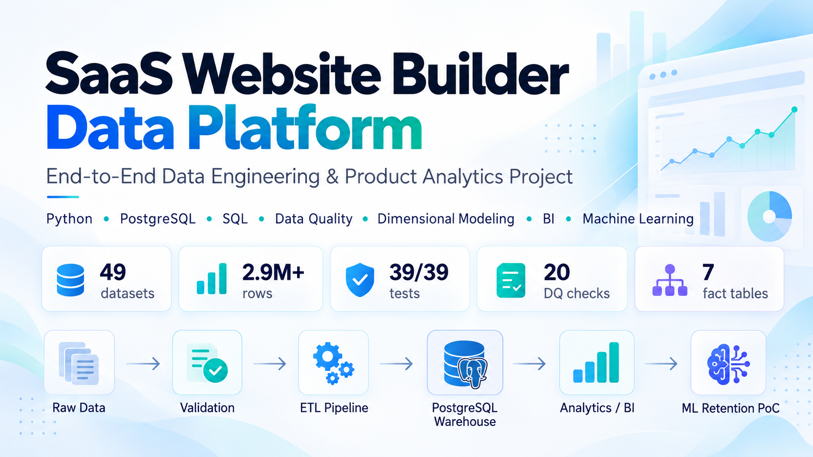
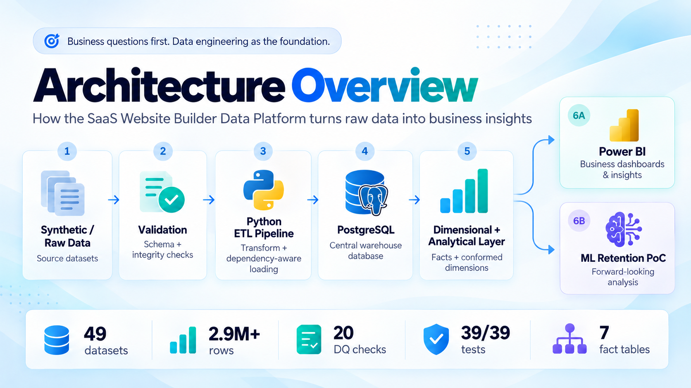
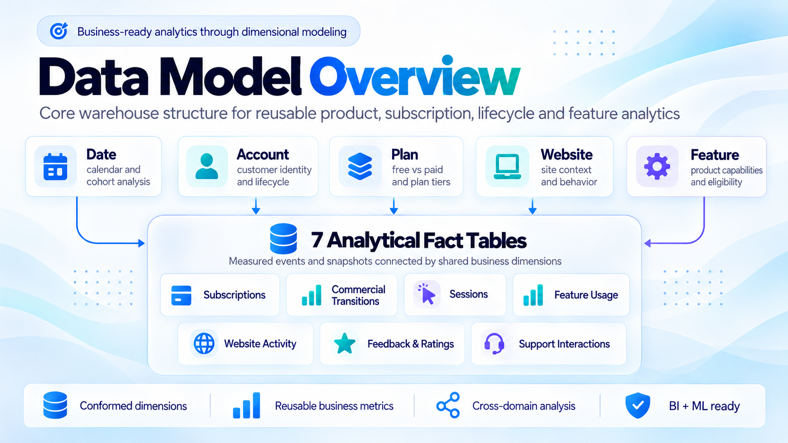
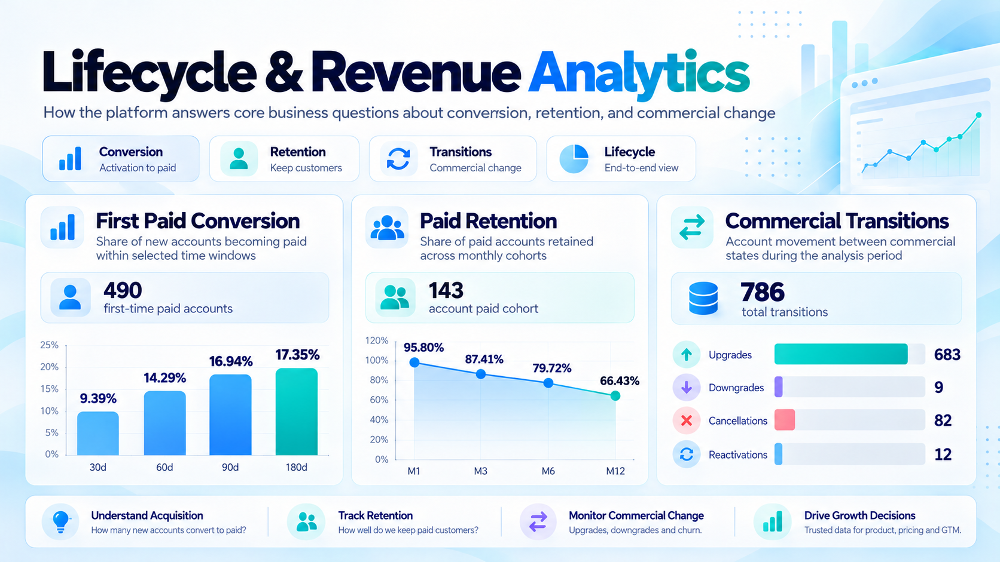
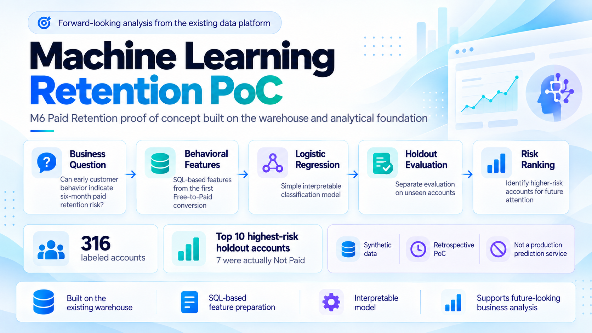

# SaaS Website Builder Data Platform

<p align="center">
  
</p>

An end-to-end **Data Engineering, Product Analytics & Applied Machine Learning portfolio project** built around a fictional Website Builder SaaS company.

The project starts with **business questions**: how users convert, retain, engage with the product, move between commercial states, and where product or customer signals may support better decisions.

To answer those questions, I built the supporting data foundation: synthetic source data, validation, a Python ETL pipeline, PostgreSQL, dimensional modeling, analytical SQL, serving views and Power BI.

A later Machine Learning extension explores whether the same platform can also support **forward-looking paid-retention analysis**.

> **Project context:** This is a local portfolio project built with synthetic data.  
> Development was **human-directed and strongly AI-assisted** across learning, design, implementation, debugging, testing and documentation.

---

## The Project in One View

The project follows one main idea:

```text
Business Questions
        ↓
Reliable Data Foundation
        ↓
Dimensional & Analytical Modeling
        ↓
Business-Facing Analytics
        ↓
Power BI Decision Support
        ↓
Machine Learning Exploration
```

The technical components are not the final goal by themselves.

They exist to transform raw product data into **reliable, interpretable business information**.

---

## What This Project Demonstrates

The project connects areas that are often presented separately:

- **Business & system thinking** — translating a SaaS business into actors, entities, lifecycle states, relationships and analytical questions.
- **Data engineering** — ingestion, validation, dependency-aware loading, transactional safety, duplicate handling and rerun behavior.
- **Data modeling** — relational, historical and dimensional structures designed around analytical grain and reusable business dimensions.
- **Analytics** — defining populations, denominators, time semantics and metric contracts before implementing SQL.
- **Business intelligence** — translating analytical outputs into interpretable Power BI dashboards and management-facing signals.
- **Reliability** — Data Quality rules, automated tests, reconciliation and serving-layer validation.
- **Applied Machine Learning** — using the existing platform for a small retrospective paid-retention proof of concept.

---

## Business Context

The fictional product is a **Website Builder SaaS platform**.

Its data represents three connected perspectives:

1. The SaaS company operating the product.
2. Customers who create and manage websites.
3. Visitors and members who interact with those websites.

Keeping these perspectives separate is important because:

`Account` ≠ `SaaS User` ≠ `Website Member` ≠ `Visitor`

Each represents a different actor and can belong to a different analytical population.

Representative business questions include:

- How quickly do new accounts convert to paid plans?
- How well are paid customers retained over time?
- How do customers upgrade, downgrade, cancel or reactivate?
- Which features are actually being used?
- How are websites, visitors, feedback and support activity behaving?
- Can early customer behavior help identify future paid-retention risk?

[Explore the Business & Data Model](docs/core/01_business_and_data_model.md)

---

## End-to-End Data Platform

The business questions required a reliable data foundation before meaningful analytics could be produced.

<p align="center">
  
</p>

At a high level, the platform moves through:

**Synthetic / Raw Data → Validation → Python ETL → PostgreSQL → Analytical Layer**

The analytical outputs then support two business-facing directions:

- **Power BI** for descriptive and decision-support analytics.
- **Machine Learning PoC** for forward-looking experimentation.

The platform was designed around:

- validation before load
- historical correctness
- transactional safety
- explicit dependency handling
- idempotent / repeatable processing
- clear analytical definitions
- multiple independent validation layers

[Explore the Data Platform](docs/core/02_data_platform.md)

---

## Data Model & Warehouse

The PostgreSQL layer is not only an operational database.

A dimensional analytical model was built so that the same business dimensions can be reused across multiple analytical domains.

<p align="center">
  
</p>

The model uses shared dimensions such as:

- **Date**
- **Account**
- **Plan**
- **Website**
- **Feature**

These connect analytical fact tables covering customer lifecycle, commercial activity, sessions, website behavior, feature usage, feedback and support interactions.

This structure supports:

- reusable business definitions
- cohort and lifecycle analysis
- cross-domain questions
- consistent BI metrics
- downstream Machine Learning feature preparation

The objective is to make analytical logic reusable rather than rebuilding business meaning inside every individual query or dashboard.

[Explore the Business & Data Model](docs/core/01_business_and_data_model.md)  
[Explore the Data Platform](docs/core/02_data_platform.md)

---

## Analytics & Business Questions

The analytical layer was built around **realistic product and management questions**, not around arbitrary metrics.

<p align="center">
  
</p>

Representative analytical areas include:

- **First Paid Conversion**
- **Paid Retention**
- **Commercial Transitions**
- **Product vs Paid Activity**
- **Eligibility-Aware Feature Adoption**
- **Website Outcomes**
- **Audience & Engagement**
- **Feedback & Ratings**
- **Support Activity**

For example, the platform can answer questions such as:

- What share of new accounts become paid within 30, 60, 90 or 180 days?
- How much of a paid cohort remains paid after 1, 3, 6 or 12 months?
- How many commercial transitions are upgrades, downgrades, cancellations or reactivations?
- Are customers using the features that are actually available to their plan?
- How do website activity and customer feedback change over time?

Each analytical output follows the same reasoning process:

```text
Business Question
        ↓
Population
        ↓
Grain
        ↓
Time Definition
        ↓
Metric Contract
        ↓
SQL
        ↓
Serving Output
        ↓
Business Interpretation
```

This keeps the analytical definition separate from the visualization layer.

[Explore the Analytics](docs/core/03_analytics.md)

---

## Dashboard & Storytelling

The Power BI layer is where the technical platform becomes **business-facing decision-support information**.

The dashboard contains three business-oriented pages:

- **Customer Lifecycle & Multi-Dimensional Health**
- **Website Audience Activity, Engagement & Feedback**
- **SaaS Product & Strategy Signals**

The dashboard was designed around management and product questions rather than around displaying as many metrics as possible.

Its purpose is to translate validated analytical outputs into signals that can support:

- acquisition analysis
- customer retention
- commercial monitoring
- product adoption
- website engagement
- customer feedback
- operational and product decision-making

The repository also contains dashboard preview images under:

`assets/dashboard/`

[Explore Dashboard & Storytelling](docs/core/04_dashboard_and_storytelling.md)

---

## Machine Learning Extension — M6 Paid Retention

After using the platform to understand historical behavior, I explored whether the same data foundation could support a **forward-looking business question**:

> Can customer behavior observed around the first Free-to-Paid conversion help identify accounts that may no longer be paid six months later?

<p align="center">
  
</p>

The experiment includes:

- SQL-based feature preparation.
- A labeled dataset of **316 accounts**.
- Three customer-behavior features.
- A **Logistic Regression** model.
- A separate holdout evaluation.
- Risk ranking of holdout accounts.
- **7 actual Not Paid accounts among the 10 highest-risk accounts** in the evaluated holdout.

The experiment intentionally remains modest in scope.

It uses **synthetic data** and is a **retrospective proof of concept**, not a production prediction service.

The purpose of this extension was to test how the existing Data Engineering and Analytics foundation could also support an ML workflow without rebuilding the project around Machine Learning.

[Explore the Machine Learning Extension](ml/README.md)

---

## Reliability & Validation

Reliability is implemented as multiple validation mechanisms rather than one generic test stage.

```text
Source Data
    ↓
Input Validation
    ↓
Transformation & Integrity Checks
    ↓
Transactional Load
    ↓
Database Constraints
    ↓
Data Quality
    ↓
Reconciliation
    ↓
Analytical / Serving Validation
    ↓
Power BI
```

The project separately tracks:

- **Data Quality rules**
- **Software tests**
- **Database constraints**
- **Reconciliation checks**
- **Serving-layer validation**

These mechanisms answer different questions and are intentionally kept separate.

For example:

- A software test checks implementation behavior.
- A Data Quality rule checks properties of the loaded data.
- Reconciliation checks whether expected counts and relationships match.
- Serving validation checks whether analytical outputs remain consistent.

[Explore Reliability & Validation](docs/core/05_reliability_and_validation.md)

---

## Technology Stack

### Data Engineering

**Python · pandas · PostgreSQL · Batch Ingestion · Validation · Transactional Loading**

### Data Modeling

**Domain Modeling · Relational Modeling · Historical Modeling · Dimensional Modeling · Grain Definition**

### Analytics

**SQL · Cohort Analysis · Retention · Conversion · Product Analytics · Lifecycle Analytics**

### Quality

**pytest · Data Quality Rules · Reconciliation · Integrity Validation**

### Business Intelligence

**Power BI · Serving Views · Semantic Modeling · Dashboard Storytelling**

### Machine Learning

**Python · pandas · scikit-learn · Logistic Regression · Feature Engineering · Holdout Evaluation**

---

## Human-Directed, AI-Assisted Development

AI was used extensively throughout the project as both a **learning tool and development tool**.

It supported implementation-heavy work including:

- Python development
- SQL development
- pipeline implementation
- analytical translation
- debugging
- test development
- validation logic
- documentation
- iterative learning and explanation

The workflow remained human-directed:

```text
Business Question / Requirement
        ↓
Discussion & Design
        ↓
AI-Assisted Implementation
        ↓
Local Execution
        ↓
Result / Error Review
        ↓
Correction & Iteration
        ↓
Validated Result
```

The project direction remained driven by the overall business problem.

Business questions, requirements, project goals, review, local execution, validation, interpretation and design decisions remained part of the human workflow.

AI assistance was particularly significant in translating those decisions into working technical artifacts.

The implementation was repeatedly executed, inspected, tested and refined locally rather than treating generated code as automatically correct.

[Read more about the AI-assisted workflow](docs/deep-dive/ai_assisted_development.md)

---

## Explore the Project

### Core Story

- [Business & Data Model](docs/core/01_business_and_data_model.md)
- [Data Platform](docs/core/02_data_platform.md)
- [Analytics](docs/core/03_analytics.md)
- [Dashboard & Storytelling](docs/core/04_dashboard_and_storytelling.md)
- [Reliability & Validation](docs/core/05_reliability_and_validation.md)
- [Machine Learning Extension](ml/README.md)

### Deep Dive

- [Engineering Decisions](docs/deep-dive/engineering_decisions.md)
- [Build Journey](docs/deep-dive/build_journey.md)
- [Reproducibility](docs/deep-dive/reproducibility.md)
- [AI-Assisted Development](docs/deep-dive/ai_assisted_development.md)
- [Limitations & Future Roadmap](docs/deep-dive/limitations_and_roadmap.md)

### Reference

- [Glossary](docs/reference/glossary.md)
- [Data Lineage](docs/reference/data_lineage.md)
- [Schema Reference](docs/reference/schema_reference.md)
- [Metric Reference](docs/reference/metric_reference.md)

---

## Project Status

The initial Data Engineering, Analytics and Power BI platform was published as:

**[v1.0.0](https://github.com/KerenGrab/saas-website-builder-data-platform/releases/tag/v1.0.0)**

A reproducible **M6 Paid Retention Machine Learning proof of concept** was subsequently added to `main`.

Its code, labeled dataset, experiment report and setup instructions are available under:

[`ml/`](ml/README.md)

The ML extension is an offline retrospective experiment and does **not** modify the existing operational data pipeline.

---

## Reproduction Verification

A fresh local clone was used to verify the frozen data release, PostgreSQL loading, Data Quality checks, serving views and automated tests.

The reproduction process is documented here:

[Reproduction Verification Report](docs/reproduction_verification.md)

---

## Repository Structure

```text
saas-website-builder-data-platform/
│
├── assets/          # Portfolio visuals, diagrams and dashboard previews
├── dashboard/       # Power BI / dashboard-related project artifacts
├── data/            # Synthetic and frozen project datasets
├── diagrams/        # Modeling and system diagrams
├── docs/            # Core story, deep dives and reference documentation
├── evidence/        # Validation and supporting evidence
├── generator/       # Synthetic data generation
├── ml/              # M6 Paid Retention proof of concept
├── pipeline/        # Data pipeline implementation
├── sql/             # Analytical and supporting SQL
├── tests/           # Automated software tests
│
├── run_pipeline.py
├── requirements.txt
├── requirements-dev.txt
├── requirements-ml.txt
└── README.md
```

---

### Project Focus

**Business Thinking → Reliable Data → Analytics → Decisions → Forward-Looking Exploration**

The project is ultimately about using a structured data platform to turn a fictional SaaS product into something that can be **measured, analyzed and reasoned about from a business perspective**.